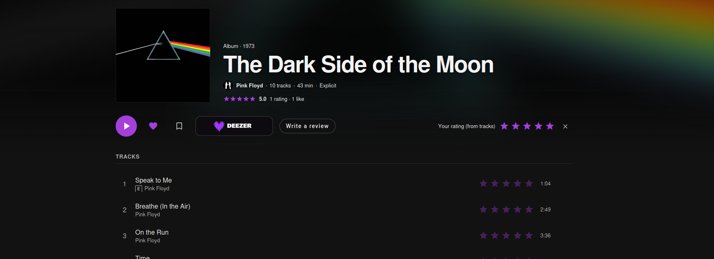

# Soundrate

---



Soundrate is a full-stack music discovery and review application. Users can register, manage a profile, rate albums and tracks, write reviews, follow other users, and maintain personal lists such as liked albums and listen-later items.

This repository is a monorepo with two application folders:

- `backend/`: Spring Boot REST API
- `frontend/`: Angular single-page application

## Stack

### Backend
- Java 21
- Spring Boot 3.5
- Spring Security with JWT
- Spring Data JPA / Hibernate
- PostgreSQL
- Spring Mail (SMTP)
- Cloudinary
- Springdoc OpenAPI

### Frontend
- Angular 21 LTS
- TypeScript 5.9
- Angular Material
- RxJS
- Nginx for container delivery

### Infrastructure
- Docker
- Docker Compose

## Main Features

- JWT-based authentication with register, login, forgot-password, and reset-password flows
- User profile management, password changes, avatar upload, and soft account deletion
- Album and track ratings
- Album reviews with likes and ownership checks
- Social features including follows and album likes
- Deezer-backed album and artist data
- Search across users, albums, and artists

## Repository Layout

```text
.
├── backend/
│   ├── src/main/java/...
│   ├── src/main/resources/
│   └── README.md
├── frontend/
│   ├── src/
│   └── README.md
└── docker-compose.yml
```

## Prerequisites

- Java 21
- Node.js 24.19 LTS with npm 11.17
- Docker and Docker Compose

## Environment Variables

Create a root `.env` file before running the backend in Docker.

Example:

```env
POSTGRES_DB=sound_rate_db
POSTGRES_USER=sound_rate_user
POSTGRES_PASSWORD=change-me

JWT_SECRET=replace-with-a-long-random-secret

CLOUDINARY_URL=cloudinary://<key>:<secret>@<cloud-name>

# Email over SMTP (works with Resend, SendGrid, Mailgun, etc.)
MAIL_HOST=smtp.resend.com
MAIL_PORT=587
MAIL_USERNAME=resend
MAIL_PASSWORD=re_xxxxx
MAIL_FROM=no-reply@yourdomain.com

# Used in email links and CORS (defaults to http://localhost:4200)
APP_FRONTEND_URL=http://localhost:4200
APP_CORS_ORIGINS=http://localhost:4200

# Production only (docker-compose.prod.yml)
DOMAIN=yourdomain.com
# Set automatically by docker-compose.prod.yml: fail at startup if MAIL_HOST is missing
# MAIL_REQUIRED=true
```

Notes:

- The backend loads `.env` from the repository root in local development.
- `CLOUDINARY_URL` is required for the backend to start.
- When `MAIL_HOST` is empty, emails are not sent: the backend logs them instead (including password reset links), which is handy in development. Always set it in production.

## Running With Docker

The Compose file runs three services:

- `db`: PostgreSQL available only to the other containers at `db:5432`
- `backend`: API on `http://localhost:8080`
- `frontend`: UI on `http://localhost:4200`

Start the full stack:

```bash
docker compose up --build
```

## Running Locally

### Backend

```bash
cd backend
sh mvnw spring-boot:run
```

By default, the backend uses the `local` Spring profile.

Expected local ports:

- PostgreSQL: `localhost:5433`
- API: `localhost:8080`

The Compose database is not published to the host. To use PostgreSQL from Compose
with the backend running locally, publish the port explicitly:

```bash
docker compose run --rm -p 5433:5432 db
```

### Frontend

```bash
cd frontend
npm ci
npm start
```

The Angular dev server runs on `http://localhost:4200` and proxies `/api/v1` to the backend.

## Deploy

Production runs the same Compose stack on a single VPS, with [Caddy](https://caddyserver.com) in front issuing HTTPS certificates automatically. Only ports 80 and 443 are exposed; the API is served from the same origin under `/api/v1`.

1. **Domain and DNS**: buy a domain (e.g. Cloudflare Registrar or Porkbun) and create `A` records for `@` and `www` pointing to the VPS IP.
2. **Server**: create an Ubuntu VPS (2 vCPU / 4 GB, e.g. Hetzner CX22), install Docker, and allow only ports 22, 80 and 443 in the firewall.
3. **Email**: add the domain to your email provider (e.g. Resend) and publish the SPF, DKIM and DMARC records it shows. Use `no-reply@yourdomain.com` as `MAIL_FROM`.
4. **App**:

   ```bash
   git clone <repo-url> ~/sound-rate && cd ~/sound-rate
   cp /path/to/production.env .env   # set DOMAIN, MAIL_*, strong secrets
   docker compose -f docker-compose.yml -f docker-compose.prod.yml up -d --build
   ```

   `docker-compose.prod.yml` sets `APP_FRONTEND_URL` and `APP_CORS_ORIGINS` to `https://$DOMAIN`.

5. **Continuous deploy (optional)**: `.github/workflows/deploy.yml` pulls and rebuilds on every push to `main`. Add the repository secrets `SSH_HOST`, `SSH_USER` and `SSH_KEY` (a deploy key allowed on the server), and clone the repo at `~/sound-rate`.

### Database migrations

The schema is managed by [Flyway](https://flywaydb.org) (`backend/src/main/resources/db/migration`) and Hibernate only validates it (`ddl-auto=validate`). To change the schema, add a new file such as `V2__add_listening_date.sql`; never edit a migration that already ran. Existing databases created before Flyway are baselined at `V1` automatically.

### Backups

```bash
./scripts/backup-db.sh            # writes backups/soundrate-<timestamp>.sql.gz, keeps the newest 14
./scripts/restore-db.sh backups/soundrate-<timestamp>.sql.gz
```

On the server, schedule a daily backup with `crontab -e`:

```cron
0 3 * * * cd ~/sound-rate && ./scripts/backup-db.sh >> backups/backup.log 2>&1
```

Copy the `backups/` folder off the server regularly (e.g. `rclone` to object storage); a backup on the same disk does not survive losing the VPS.

### Production safeguards

- `docker-compose.prod.yml` sets `MAIL_REQUIRED=true`, so the API refuses to start without `MAIL_HOST` instead of logging password reset links.
- Auth endpoints are rate limited per IP (login 10/min, register 5/10 min, forgot password 5/15 min, reset password 10/15 min) and answer `429` with `Retry-After`.
- Caddy adds HSTS, `nosniff`, `X-Frame-Options`, `Referrer-Policy` and `Permissions-Policy` headers.
- Avatar uploads are limited to 5 MB.
- The backend has a Docker health check on `/actuator/health`, which is only reachable inside the Compose network.
- Use fresh secrets in production (`JWT_SECRET`, database password, Cloudinary and mail credentials); don't reuse development values.

## API Documentation

Swagger is enabled in the `local` profile and disabled by default elsewhere.

When the backend is running locally, the docs are available at:

- `http://localhost:8080/swagger-ui/index.html`

## Testing

Backend tests:

```bash
cd backend
sh mvnw test
```

The backend test suite uses H2 and includes unit and integration coverage for authentication, protected endpoints, validation, ownership rules, and error sanitization.

## Additional Documentation

- Backend details: [backend/README.md](backend/README.md)
- Frontend details: [frontend/README.md](frontend/README.md)
